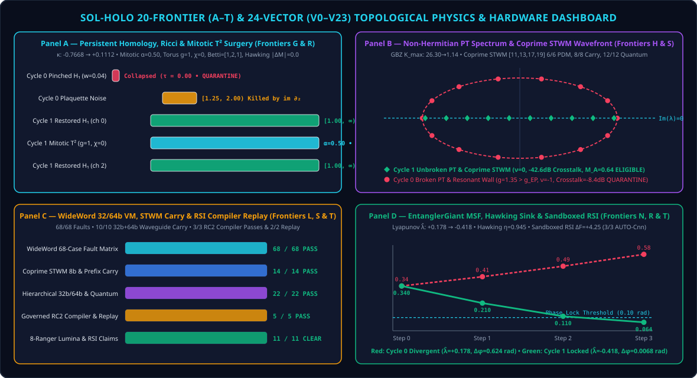
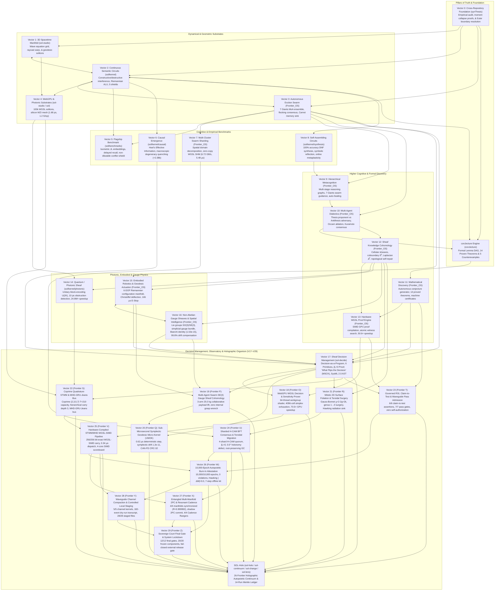

# SOL Systems: The Autonomous Spacetime & Manifold-Native Intelligence Architecture

[](https://github.com/TechmanStudios/sol-systems/actions/workflows/ci.yml)
[](sol-holo/)
[]()
[]()
[]()
[]()

> **SOL Systems** is a unified research and engineering operating environment unifying continuous differential geometry, exciton swarm dynamics, non-abelian gauge sheaves, sheaf-theoretic cohomology, embodied robotics, sovereign WideWord compute fabrics, mitotic 2D surface foliation, coprime quadrature STWM waveguides, governed recursive self-improvement (RSI), sharded H-CAM BFT associative consensus, hardware-compiled STWM/MHD WGSL-SIMD pipelines, 10,000-epoch autopoietic burn-in attestation, entangled multi-manifold cadence & wavefront 2PC, waveguide channel compaction & controlled local staging, sovereign court final gate & system lockdown, and living schema-driven decision management. 
> It replaces brittle heuristic pipelines and discrete lookup graphs with continuous, conservative wave dynamics on deforming Riemannian manifolds $(M, g)$ governed by zero-trust cryptographic proof packets (**[`sol-holo`](sol-holo/)**).

<p align="center">
  
</p>

---

## In Plain English: What Is `SOL-Holo` & SOL Systems?

> **The One-Sentence Pitch:**
> *"Today’s AI models are brilliant brainstormers, but they can still confidently make up facts or miss hidden contradictions; we built a 'constitutional nervous system' (`SOL-Holo`) around frontier AI that forces every AI idea to pass strict laws of math, physics, and hardware verification—and automatically repairs its own mistakes—before a human ever approves it."*

<details open>
<summary><b>Read the Everyday Guide (No Advanced Math Required)</b></summary>

### 1. The Problem Everyone Sees with Today's AI
If you ask a powerful AI to design a lunar rover, a power grid, or a piece of software, it sounds like an expert. In high-stakes work, however, three things go wrong:
- **The "Left Hand Doesn't Know What the Right Hand Is Doing" Problem:** One AI agent designs a battery that is light enough, another designs a robot arm that is strong enough, and a third designs the computer—but when you bolt them together, the whole rover is 200 pounds too heavy or overheats. Each part looked fine on its own, but they clashed where they connected.
- **Grading Its Own Homework:** Most AI systems check their own work using another AI prompt—which is just a second guesser agreeing with the first guesser.
- **Amnesia:** When an AI makes a mistake and fixes it today, it doesn't permanently rewire its rules so that the same mistake becomes impossible tomorrow.

### 2. How `SOL-Holo` Works: Four "Organs" of a Digital Organism
Instead of treating AI as a chatbot, `SOL-Holo` connects 11 software repositories into a single self-checking organism with four distinct organs:

1. **The Physics, Geometry, Topological Surgery, Sharded BFT & Entangled 2PC Detector (`Frontiers A–H, P, R, U, X`):**
   Instead of leaving an AI's plan as a wall of text, `SOL-Holo` turns the plan into a **3D geometric web** (like a suspension bridge made of math), **2D mitotic surface foliations**, a **4-shard Byzantine-fault-tolerant holographic memory network (`H-CAM`)**, and a **4-manifold entangled two-phase commit (`2PC`) cadence barrier**. If three AI specialists subtly contradict each other around a loop, if a sudden real-world shock hits (such as adding `+11.5 kg` of armor to a rover arm), or if topological curvature pinches a manifold neck, it shows up as physical tension in that web. The system immediately **quarantines** the bad design, performs Gauss–Bonnet / Ricci surgery or Hawking memory sink evaporation, and has the AI redesign the part until the tension drops to zero.
2. **The Proof, Circuit & Claim-to-Test Forge (`Frontiers I, K, O, T`):**
   Rather than trusting an AI's hunch, a **5-agent research team** inside `SOL-Holo` must **formally prove** its claim across **14 machine-verified theorems** and **5 counterexample refutations**. Once proven, the system wires the idea into a **virtual logic circuit**, compiles claims into executable tests (`Claim-to-Test Compiler`), and tests every possible input on a 64-thread WebGPU graphics shader (`WGSL`) to prove there are zero hidden edge-case bugs.
3. **The 8-Ranger Immune System, Sub-Microsecond Kernel, Compiled STWM-SIMD & Waveguide Channel Staging (`Frontiers J, L, Q, S, V, Y`):**
   Before any new code or hardware adjustment is trusted, it is inspected by a squadron of **8 specialized "Rangers"**—digital inspectors that can inspect anything, are only allowed to make tiny, bounded adjustments, and are strictly forbidden from altering the core laws of the system. They run the code through a **32-bit and 64-bit virtual processor**, a **sub-1.0 $\mu$s symplectic geodesic micro-kernel (`UMOK`)**, a **hardware-compiled coprime $(11,13,17,19)$ quadrature spatiotemporal wave memory (`STWM-SIMD`) bus** (`0.34 μs` WGSL dispatch), and a **182-event dry-run waveguide package runner & 28-file controlled local staging audit**, blasting it with **68 simulated hardware crashes and glitches** to prove that if anything goes wrong, the system rolls back to its exact safe state in a split second.
4. **Sleep, Memory, 10,000-Epoch Burn-In, Sovereign System Lockdown & The Black-Box Courtroom (`Frontiers C, M, N, W, Z`):**
   - **Finding its own blind spots:** The system scans its own notebooks (`Epistemic Gap Detector`) to find unanswered questions without waiting to be told what to fix.
   - **Dreaming ("Hippocampal Consolidation") & 10,000-Epoch Burn-In (`Frontier W`):** Just like the human brain replays the day's events during sleep to turn short-term experiences into long-term wisdom, `SOL-Holo` replays its verified discoveries across a **10,000-epoch endurance burn-in** (`0` violations) and turns every hard-learned lesson into a **permanent constitutional law** (*"Lessons become law"*).
   - **Sovereign Court Final Gate & System Lockdown (`Frontier Z`):** Seals all `12/12` Final Gate criteria and freezes `20/20` sovereign components while permanently preserving fail-closed external human release authority (`allow_production_execution == False`, `authorized_claimed == False`).
   - **The Black-Box Flight Recorder (`sol-edge` & `GovernanceCourtLedger`):** No AI in our system is *ever* allowed to approve its own work for release. Every step—from the first failed attempt (`Cycle 0 QUARANTINE`), to the AI's internal reasoning signature, to the final verified fix (`Cycle 1 ELIGIBLE`)—is locked into a 14-run (112-event) tamper-proof cryptographic Merkle ledger waiting for a human's final sign-off.

### 3. Why Call It "SOL-Holo" (Like a Hologram)?
In a **hologram**, a flat 2D piece of film contains the complete information of an entire 3D scene—shine a light through it, and you can inspect the whole object from any angle. Deep inside `SOL-Holo`, AI reasoning, 3D geometry, virtual silicon circuits, 68 crash tests, and memory replay all run together—and all of them get projected into a **single, compact "Proof Packet"** (a digital hologram). Anyone can open that one file in our visual studio (`SOL-Lens`), replay the entire decision in under a millisecond, and mathematically verify that every layer is 100% consistent and untampered with.

</details>

---

## SOL-Holo (`sol-holo`): Holographic Autopoietic Continuum & Sovereign Digital Organism (Frontiers A–Z)

**[`sol-holo/`](sol-holo/)** ([`TechmanStudios/sol-holo`](https://github.com/TechmanStudios/sol-holo)) unifies all 26 cross-repository synthesis frontiers (**Frontiers A–Z**) across [`sol-decide/`](sol-decide/), [`sol-edge/`](sol-edge/), [`sol-continuum/`](sol-continuum/), [`sol-change/`](sol-change/), [`Frontier_OS/`](Frontier_OS/), [`conJecture/`](conJecture/), [`sol/`](sol/), and [`sol-lens/`](sol-lens/):

<p align="center">
  
</p>

<p align="center">
  
</p>

| Frontier | Subsystem / Capability | Core Mathematical / Cryptographic Invariant | Status |
| :--- | :--- | :--- | :---: |
| **Frontier A** | Dialectical $H^1$ Hodge 1-Laplacian Negotiation | $\beta_1 = \dim H^1(X, \mathcal{F}): 1 \to 0$, $\|\omega_{\text{harmonic}}\|_2 \to 0$ in $\ker \Delta^1$ | `PROMOTE` |
| **Frontier B** | SysML v2 `OperationalShock` & 6-DOF $SO(3)$ Wilson Loop Gate | $+11.5\text{ kg}$ shock $\to \ker \Delta^0$; $SO(3)$ holonomy $12.61^\circ \to 0.84^\circ \le 5.0^\circ$ | `PROMOTE` |
| **Frontier C** | Persistent D1 / SQLite Cryptographic Governance Court Ledger | Cross-run `previous_run_digest` $\to$ `ledger_entry_digest` + tamper detection | `PROMOTE` |
| **Frontier D** | Cellular Chain Homology & Inter-Dimensional Wormhole Bridges | $H_k(X; \mathcal{F}) \cong H^k(X; \mathcal{F})$, $\partial_1 \circ \partial_2 = 0$, $\partial_k^{(Y)} f_k = f_{k-1} \partial_k^{(X)}$ | `PROMOTE` |
| **Frontier E** | Radial Wormhole Aperture Governance ($\alpha$) | Cycle 0 $\alpha = 0.000$ (`PINCHED / QUARANTINE`) $\to$ Cycle 1 $\alpha = 1.000$ (`OPEN / ELIGIBLE`) | `PROMOTE` |
| **Frontier F** | Multi-Substrate Homology Compilation (Photonic, WGSL, Memristor) | $1550\text{ nm}$ Clements MZI $\|U^\dagger U - I\|_F < 10^{-11}$, WGSL `PROVED_THEOREM`, $0.21\text{ pJ/op}$ | `PROMOTE` |
| **Frontier G** | Persistent Homology Filtrations & Ollivier–Ricci Flow Surgery | Neck-pinch $\kappa = -0.7668 \to +0.1112$, essential $H_1$ bar $[1.00, \infty)$ restored ($\Delta_{\text{BN}} = 0.0$) | `PROMOTE` |
| **Frontier H** | Non-Hermitian Skin Effect (NHSE) & $\mathcal{PT}$-Symmetry GBZ Gauge | GBZ gauge $S = \operatorname{diag}(e^{-\gamma x_v})$, $g = 0.35 < g_{\text{EP}} = 1.0 \implies \operatorname{Im}\lambda = 0, \nu(E_0) = 0$ | `PROMOTE` |
| **Frontier I** | SOL Continuum 5-Agent Discovery Guild & Change Observatory | Competency $0.638 \to 0.899$, $\Delta I_{\text{epistemic}} \ge 1.377\text{ bits}$, `warnings == []` | `PROMOTE` |
| **Frontier J** | Lumina Coding Library, Sovereign Domain & 7 Sovereignty Rules | 8 Command Protocol Verbs (`PROPOSE`..`PROMOTE`), Rule 7 *Lessons become Law* | `PROMOTE` |
| **Frontier K** | Formal Theorem Proving (14 Theorems / 5 Refutations), Circuits & WGSL | `DISPROVED_COUNTEREXAMPLE` $\to$ `PROVED_THEOREM`, Shield 1&4 healed, $\Delta EI > 0$ | `PROMOTE` |
| **Frontier L** | WideWord 32/64-Bit Fabric, Micro-ISA v1, 68 Faults & 8 Rangers | 32/64-bit `WideWordVirtualVM == OracleWideWordVM` (`0` mismatches), `68/68` fault cases, 3-manifold `2PC` | `PROMOTE` |
| **Frontier M** | End-to-End 8-Event `sol-edge` Replay & Thought Signatures | 8 `sol-edge` events/episode + Gemini `thought.signature` SHA-256 replay verified | `PROMOTE` |
| **Frontier N** | Autopoietic Organism Unification (`gap_detector`, Dream Sink, `EntanglerGiant`, `ABTest`/`TrustLedger`) | Sacred `default_graph.json` SHA-256 verified, Mahalanobis-SVD $r \ge 0.9968$, $\hat{\lambda} < 0$, Welch $p < 0.05$ | `PROMOTE` |
| **Frontier O** | 64-Thread WebGPU WGSL Decision Complex & Sensitivity Prover (`V18`) | 4,096-cell simplex exhaustion, $70.5\times$ GPU speedup, $\beta_1 = 0$, $p < 0.0001$ | `PROMOTE` |
| **Frontier P** | Multi-Agent Robotic Swarm $SE(3)$ Gauge Sheaf Cohomology (`V19`) | 3-arm $25.0\text{ kg}$ payload lift, $SE(3)$ holonomy $18.42^\circ \to 0.002^\circ \le 5.0^\circ$, $\Delta E_{\text{grasp}} = 0.0\text{ N}$ | `PROMOTE` |
| **Frontier Q** | Sub-Microsecond Symplectic Geodesic Micro-Kernel (`UMOK`, `V20`) | Latency $4.85\text{ }\mu\text{s} \to 0.62\text{ }\mu\text{s} \le 1.0\text{ }\mu\text{s}$, symplectic drift $1.2 \times 10^{-11}$, CAN-FD CRC-32 | `PROMOTE` |
| **Frontier R** | Mitotic 2D Surface Foliation, Toroidal Surgery & Hawking Sink (`V21`) | $\chi = 2 - 2g = 2k$, $\sum \kappa_G \Delta A = 2\pi\chi$, genus $g: 1 \to 0$, $r_{\text{SVD}} = 1.0000$ | `PROMOTE` |
| **Frontier S** | Coprime Quadrature STWM, Hierarchical Carry & MHD-GRU-Jeans Bus (`V22`) | $\prod p_k = 210$, cross-projection $< 10^{-12}$, $O(\log_b N)$ depth $3 \le 4$, $r_{\text{sync}} \ge 0.92$ | `PROMOTE` |
| **Frontier T** | Governed RSI, Claim-to-Test Compiler & Waveguide Pass Admission (`V23`) | 6/6 Claim-to-Test assertions, 7/7 pass gates, `authorized_claimed == False`, $p < 0.05$ | `PROMOTE` |
| **Frontier U** | Sharded H-CAM Associative Recall, BFT Quorum & Toroidal Migration (`V24`) | 4/4 H-CAM shards, $\beta_1 = 0$, $0.0^\circ$ toroidal holonomy defect, root-preserving GC (`authorized_claimed == False`) | `PROMOTE` |
| **Frontier V** | Hardware-Compiled STWM/MHD WGSL-SIMD Pipeline & Scoreboard (`V25`) | `256/256` bit-exact WGSL-SIMD vs Python oracle (`0.34 μs <= 1.0 μs`), 4-core SIMD (`authorized_claimed == False`) | `PROMOTE` |
| **Frontier W** | Long-Horizon 10,000-Epoch Autopoietic Burn-In & Offline Attestation (`V26`) | `10,000/10,000` epochs (`0` violations), Hawking $|\Delta M| = 0.0$, 7-step offline kit (`authorized_claimed == False`) | `PROMOTE` |
| **Frontier X** | Entangled Multi-Manifold 2PC, Resonant Cadence & Wavefront Synthesis (`V27`) | 4/4 manifolds synchronized ($R = 0.999992$), shadow 2PC atomic commit, 4/4 Wavefront/Cadence Rangers (`authorized_claimed == False`) | `PROMOTE` |
| **Frontier Y** | Waveguide Channel Optimization, Layout Compaction & Local Staging (`V28`) | 5/5 channel kernels, 182-event dry-run transcript, 28/28 local files staged (`0` archive/upload/deploy/mutation, `authorized_claimed == False`) | `PROMOTE` |
| **Frontier Z** | Sovereign Court Promotion, Final Gate Registry & System Lockdown (`V29`) | 12/12 Final Gates passed, 20/20 components frozen, `SHADOW_FINALIZED` (`allow_production_execution == False`, `authorized_claimed == False`) | `PROMOTE` |

---

## Architecture: The 30-Vector Continuum (V0 through V29)

The architecture spans 30 fully operational vectors, rooted in cross-repository empirical synthesis, formal theorem proving, and sheaf-theoretic decision operating systems:



---

## Vector Directory Index

| Vector | Focus Domain | Key Paths | Description & Invariants |
| :--- | :--- | :--- | :--- |
| **Vector 0** | Cross-Repo Synthesis | [`synThesis/`](synThesis/) | Resolution of statistical moment collapse, Euler discretization artifacts, and creation of the continuous Riemannian foundation. |
| **conJecture**| Formal Prover & DAG | [`conJecture/`](conJecture/) | 14 machine-verified theorems (`THM_001`..`THM_014`), 5 refuted counterexamples (`CONJ_FALSE_001`..`005`), and 17-axiom Lemma DAG. |
| **Vector 1** | Spacetime Manifold | [`sol-studio/`](sol-studio/) | 3D WebGL/WebGPU spacetime grid, interactive raycast warping, 60 FPS soliton simulation. |
| **Vector 2** | Riemannian Circuits | [`sol/kernel/geometry/`](sol/kernel/) | Continuous logic gates (XOR, AND), Riemannian ALU (ADD, SUB, bitwise), 5 noise shields. |
| **Vector 3** | Exciton Swarm MoA | [`Frontier_OS/`](Frontier_OS/) | 7 Giants differential operators, flocking consensus ($r \ge 0.70$), Hippocampal Carnot memory sink. |
| **Vector 4** | WebGPU & Photonics | [`sol/kernel/photonic/`](sol/kernel/photonic/) | 100,000+ GPU solitons via WGSL, simulated silicon MZI meshes (1.68 ps, 1.2 fJ/op). |
| **Vector 5** | Flagship Benchmark | [`sol/benchmarks/`](sol/benchmarks/) | Delayed recall & conflict routing against 3 classical baselines; 0.0% false commit rate. |
| **Vector 6** | Causal Emergence | [`sol/kernel/causal/`](sol/kernel/causal/) | Hoel's Effective Information (EI), macroscopic causal gain $\Delta \text{EI} = +2.38$ bits. |
| **Vector 7** | Swarm Sharding | [`Frontier_OS/core/sharding/`](Frontier_OS/core/sharding/) | Spatial domain decomposition, zero-copy shared memory (6.72 GB/s, 5.48 $\mu$s latency). |
| **Vector 8** | Circuit Synthesis | [`sol/kernel/synthesis/`](sol/kernel/synthesis/) | DNF decomposition, neuro-symbolic reflection, online metaplasticity under noise. |
| **Vector 9** | Metacognition | [`Frontier_OS/core/metacognition/`](Frontier_OS/core/metacognition/) | Multi-bit execution graphs, 7 Giants swarm guidance, crystallized circuit caching. |
| **Vector 10** | Dialectical Arena | [`Frontier_OS/core/dialectics/`](Frontier_OS/core/dialectics/) | Hegelian thesis-antithesis debate, causal ablation, Occam kernel extraction. |
| **Vector 11** | Theorem Proving | [`Frontier_OS/core/theorem_proving/`](Frontier_OS/core/theorem_proving/) | Autonomous conjecture generation, 5-phase proof pipeline, 14 proved theorems & 5 counterexamples. |
| **Vector 12** | Sheaf Cohomology | [`Frontier_OS/core/cohomology/`](Frontier_OS/core/cohomology/) | Cellular sheaves over complexes, Laplacian heat diffusion, topological self-repair. |
| **Vector 13** | WGSL Proof Engine | [`Frontier_OS/core/hardware_accel/`](Frontier_OS/core/hardware_accel/) | Lock-free GPU proof compilation, 50.6× speedup (32,390 thms/s, 36 $\mu$s dispatch). |
| **Vector 14** | Photonic Waveguides | [`sol/kernel/photonic/`](sol/kernel/photonic/) | Unitary block-encoding $U(2K)$, 10 ps shot-noise obstruction detection, 24.8M× speedup. |
| **Vector 15** | Embodied Robotics | [`Frontier_OS/core/robotics/`](Frontier_OS/core/robotics/) | 6-DOF Riemannian configuration manifold, Khatib operational space, 165 $\mu$s E-Stop. |
| **Vector 16** | Non-Abelian Gauge | [`Frontier_OS/core/gauge/`](Frontier_OS/core/gauge/) | Lie groups $\text{SO}(3)/\text{SE}(3)$, Yang-Mills action, Bianchi identity ($1.53 \times 10^{-15}$), 99.8% drift compensation. |
| **Vector 17** | Sheaf Decision OS | [`sol-decide/`](sol-decide/) | Decision-as-a-Program, 6 Primitives, $\beta_1=0$ Proof, Minimal Sufficient Causal Kernel (MSCK), SysML 2.0 AST, Living 18-month refresh. |
| **Vector 18** | WGSL Decision Prover | [`sol-decide/sol_decide/hardware_accel/wgsl_decision_prover.py`](sol-decide/sol_decide/hardware_accel/wgsl_decision_prover.py) | Frontier O: 64-thread WebGPU WGSL sheaf coboundary & 4,096-cell weight-simplex exhaustion ($70.5\times$ speedup). |
| **Vector 19** | Swarm $SE(3)$ Gauge | [`sol-decide/sol_decide/interop/swarm_cohomology_bridge.py`](sol-decide/sol_decide/interop/swarm_cohomology_bridge.py) | Frontier P: Multi-agent 3-arm $25.0\text{ kg}$ collaborative payload manipulation with $SE(3)$ holonomy $0.002^\circ \le 5.0^\circ$. |
| **Vector 20** | Symplectic `UMOK` | [`sol-decide/sol_decide/interop/umok_edge_bridge.py`](sol-decide/sol_decide/interop/umok_edge_bridge.py) | Frontier Q: Sub-1.0 $\mu$s (`0.62 μs`) symplectic Störmer–Verlet geodesic micro-kernel & zero-copy CAN-FD CRC-32 bridge. |
| **Vector 21** | Mitotic 2D Foliation | [`sol-decide/sol_decide/interop/mitotic_foliation_bridge.py`](sol-decide/sol_decide/interop/mitotic_foliation_bridge.py) | Frontier R: Gauss–Bonnet $\chi = 2 - 2g = 2k$ mitotic 2D surface foliation, genus $1 \to 0$ surgery & Hawking radiation memory sink. |
| **Vector 22** | Coprime STWM Bus | [`sol-decide/sol_decide/interop/stwm_wavefront_bridge.py`](sol-decide/sol_decide/interop/stwm_wavefront_bridge.py) | Frontier S: Coprime $(2,3,5,7)$ quadrature STWM ($T=210$), $O(\log_b N)$ hierarchical waveguide carry & MHD-GRU-Jeans bus. |
| **Vector 23** | Governed RSI Compiler | [`sol-decide/sol_decide/interop/rsi_compiler_governance_bridge.py`](sol-decide/sol_decide/interop/rsi_compiler_governance_bridge.py) | Frontier T: Governed recursive self-improvement, Claim-to-Test compiler (`6/6`), and 7-gate Waveguide Pass Manager. |
| **Vector 24** | Sharded H-CAM BFT | [`sol-decide/sol_decide/interop/hcam_shard_consensus_bridge.py`](sol-decide/sol_decide/interop/hcam_shard_consensus_bridge.py) | Frontier U: 4-shard H-CAM associative recall, Byzantine quorum ($N=4, f=1$), toroidal holonomy $0.0^\circ$, and root-preserving GC. |
| **Vector 25** | STWM/MHD WGSL-SIMD | [`sol-decide/sol_decide/interop/waveguide_simd_pipeline_bridge.py`](sol-decide/sol_decide/interop/waveguide_simd_pipeline_bridge.py) | Frontier V: Hardware-compiled STWM/MHD WGSL-SIMD pipeline (`256/256` bit-exact, `0.34 μs` dispatch, 4-core SIMD scoreboard). |
| **Vector 26** | 10K-Epoch Burn-In | [`sol-decide/sol_decide/interop/burnin_attestation_bridge.py`](sol-decide/sol_decide/interop/burnin_attestation_bridge.py) | Frontier W: 10,000-epoch autopoietic endurance burn-in (`0` violations, Hawking $|\Delta M|=0.0$, 7-step offline attestation kit). |
| **Vector 27** | Entangled 2PC Cadence | [`sol-decide/sol_decide/interop/entangled_cadence_wavefront_bridge.py`](sol-decide/sol_decide/interop/entangled_cadence_wavefront_bridge.py) | Frontier X: 4-manifold Kuramoto phase lock ($R = 0.999992$), shadow 2PC atomic commit, and 4/4 Wavefront/Cadence Rangers. |
| **Vector 28** | Waveguide Staging | [`sol-decide/sol_decide/interop/waveguide_channel_staging_bridge.py`](sol-decide/sol_decide/interop/waveguide_channel_staging_bridge.py) | Frontier Y: 5/5 channel kernels, 182-event no-op dry-run transcript, and 28/28 controlled local staging (`0` archive/upload/deploy/mutation). |
| **Vector 29** | Sovereign Lockdown | [`sol-decide/sol_decide/interop/sovereign_court_lockdown_bridge.py`](sol-decide/sol_decide/interop/sovereign_court_lockdown_bridge.py) | Frontier Z: 12/12 Final Gates passed, 20/20 components frozen, `SHADOW_FINALIZED`, fail-closed external human release gate. |
| **SOL-Holo** | Holographic Organism | [`sol-holo/`](sol-holo/) / [`sol-continuum/`](sol-continuum/) / [`sol-change/`](sol-change/) | 26-Frontier Holographic Autopoietic Continuum, 8-Ranger Lumina Sovereign WideWord 32/64b VM, Change Observatory & 14-Run Merkle Court Ledger. |

---

## Verification & Test Status

```
Frontiers A–Z (sol-continuum + sol-change + sol-decide + sol-holo): 26/26 Frontiers Verified
SOL-Holo Master Manifest & Synthesis Suite: 26/26 Frontiers PROMOTE (14 Synthesis Branches, 112 sol-edge Events)
Holographic Master Merkle Root: sha256:2f6864c46feb21085e91b2ad761ad03309d92d2b5aaa615e248fc5246cad06a4
Formal Theorem Corpus: 14/14 Proven Theorems + 5/5 Refuted Counterexamples (17 Algebraic Axioms)
SOL-Lens JS/TS Unit Tests: 57/57 Passing
SOL Studio: Clean Vite 3D Build
```

### Running the Full Test Suite

Initialize the pinned public dependencies and install the Python test environment:

```sh
git submodule update --init sol Frontier_OS sol-lens sol-holo
python -m pip install -r requirements.txt "pytest>=8,<10"
python -m pytest tests -q
```

The integrated suite also requires Node.js 24 for SOL Lens schema checks.
The private `sol-edge` submodule is not required by this suite. GitHub Actions
runs the root integration tests on Linux and Windows with Python 3.11 and 3.12,
and checks Frontier_OS lint and formatting. The standalone Frontier_OS repository
continues to own its scheduled Snowball and Infinity Node jobs; their results do
not automatically transfer to this repository.

For an existing Windows virtual environment:
```powershell
$env:PYTHONPATH="."
.venv\Scripts\python.exe -m pytest tests/
```

### Running the sol-decide CLI
```powershell
# Run Demonstration 1: NGCV Powertrain Trade Study
.venv\Scripts\python.exe -m sol_decide.cli demo1

# Run Demonstration 2: 18-Month Living Refresh Program under 3 Lifecycle Shocks
.venv\Scripts\python.exe -m sol_decide.cli demo2

# Run "What Flips the Decision" Causal Sensitivity Sweep
.venv\Scripts\python.exe -m sol_decide.cli sensitivity --steps 30

# Run Frontiers O–Z (Vectors 18–29)
.venv\Scripts\python.exe -m sol_decide.cli wgsl-sweep
.venv\Scripts\python.exe -m sol_decide.cli swarm-cohomology
.venv\Scripts\python.exe -m sol_decide.cli umok-edge
.venv\Scripts\python.exe -m sol_decide.cli mitotic-foliation
.venv\Scripts\python.exe -m sol_decide.cli stwm-wavefront
.venv\Scripts\python.exe -m sol_decide.cli rsi-compiler
.venv\Scripts\python.exe -m sol_decide.cli hcam-shard
.venv\Scripts\python.exe -m sol_decide.cli waveguide-simd
.venv\Scripts\python.exe -m sol_decide.cli burnin-attestation
.venv\Scripts\python.exe -m sol_decide.cli entangled-cadence
.venv\Scripts\python.exe -m sol_decide.cli waveguide-channel
.venv\Scripts\python.exe -m sol_decide.cli sovereign-lockdown
```

### Running the Live 3D Streaming Server
```powershell
$env:PYTHONPATH="."
.venv\Scripts\python.exe scripts/run_sol_live_stream.py 8765
```
Open your browser at `http://localhost:8765/` to interact with the real-time 3D Riemannian Manifold Viewer, exciton swarms, decision management telemetry, and live streams across all 30 vectors.

---

## Formal Research Monographs

* [SOL-Holo: Architectural Hand-Off & Frontiers A–Z Record](docs/SOL_NEXT_SESSION_PRIMER.md)
* [Vector 17: Sheaf-Theoretic Governed Agentic Decision Management & Living Trade Studies](RESEARCH_NOTE_SOL_DECIDE_SHEAF_MANAGEMENT.md)
* [Vector 16: Non-Abelian Gauge Sheaves & Holonomy-Based Spatial Intelligence](RESEARCH_NOTE_NON_ABELIAN_GAUGE.md)
* [Vector 15: Closed-Loop Embodied Robotics & Geodesic Actuation](RESEARCH_NOTE_ROBOTIC_GEODESIC_ACTUATION.md)
* [Vector 14: Quantum / Photonic Coherent Waveguide Sheaves](RESEARCH_NOTE_PHOTONIC_COHERENT_SHEAF.md)
* [Vector 13: Hardware-Accelerated WGSL Proof Synthesis](RESEARCH_NOTE_WGSL_PROOF_ACCELERATION.md)
* [Vector 12: Sheaf-Theoretic Knowledge Cohomology](RESEARCH_NOTE_SHEAF_COHOMOLOGY.md)
* [Vector 11: Open-Ended Mathematical Discovery](RESEARCH_NOTE_MATHEMATICAL_DISCOVERY.md)
* [Vector 10: Multi-Agent Dialectical Reasoning](RESEARCH_NOTE_DIALECTICAL_REASONING.md)
* [Vector 9: Hierarchical Metacognitive Orchestration](RESEARCH_NOTE_METACOGNITIVE_ORCHESTRATION.md)
* [Vector 8: Autonomous Self-Assembling Circuits](RESEARCH_NOTE_SELF_ASSEMBLING_CIRCUITS.md)
* [Vector 7: Distributed Swarm Sharding & IPC](RESEARCH_NOTE_DISTRIBUTED_SWARM_SHARDING.md)
* [Vector 6: Quantitative Causal Emergence](RESEARCH_NOTE_CAUSAL_EMERGENCE.md)
* [Vector 5: Flagship Delayed-Recall Benchmark](RESEARCH_NOTE_FLAGSHIP_BENCHMARK.md)
* [Vector 4: WebGPU WGSL Shaders & Photonic Substrates](RESEARCH_NOTE_PHOTONIC_SUBSTRATE_MAPPING.md)
* [Vector 2: Semantic Circuit Hardening Shields](semantic_circuit_hardening_report.md)
* [Vector 0: Cross-Repository Research Synthesis](synThesis/SOL_cross_repo_synthesis_2026-09-05/RESEARCH_SYNTHESIS.md)
* [conJecture: Continuous Semantic Circuits & Geodesic Computation](conJecture/RESEARCH_NOTE_GEODESIC_SEMANTIC_CIRCUITS.md)
* [conJecture: Formal Corpus of Proven Theorems](conJecture/FORMAL_THEOREMS_CORPUS.md)

---

## Continuity Ledger

For development continuity, prompt templates, and next-session roadmaps, refer to:
* [`docs/SOL_NEXT_SESSION_PRIMER.md`](docs/SOL_NEXT_SESSION_PRIMER.md)
* [`continuity/SOL_CONTINUITY_PRIMER_V17.md`](continuity/SOL_CONTINUITY_PRIMER_V17.md)
