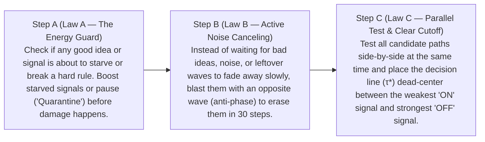

# Simplified English Companion: The Complete 5-Venue Unification & Whole-Engine Hardening Arc

**Recorded:** `2026-11-04`  
**Owner:** Bryan (`techman220@gmail.com`)  
**Companion To:** [`NEXT_RND_VENUES_ROADMAP.md`](./NEXT_RND_VENUES_ROADMAP.md), [`RESEARCH_NOTE_BICAMERAL_AUTOPOIETIC_SHEAF_AGENT.md`](../../RESEARCH_NOTE_BICAMERAL_AUTOPOIETIC_SHEAF_AGENT.md), and Live Companion Sessions [`#01`](./2026-10-27_session_01_multi_agent_flaw_resolution.md)–[`#12`](./2026-11-03_session_12_whole_engine_sigma_abc_stress_test.md)

> [!NOTE]
> **Purpose of This Companion Document:** This guide exists **alongside** our high-precision technical documents ([`NEXT_RND_VENUES_ROADMAP.md`](./NEXT_RND_VENUES_ROADMAP.md) and the session transcripts)—never in place of them. Its goal is to give both human readers and every agent in our agentic network an intuitive, plain-English mental model of **what the SOL Engine is doing as a whole**, **how all 5 R&D Venues work together**, and **what we proved during Whole-Engine Hardening**.

---

## 1. The Big Picture: What Is the "SOL Engine" Doing Here?

When we talk about the **SOL Engine** as a whole, we are talking about a **two-hemisphere ("bicameral") thinking system**:
1. **The Language Hemisphere (the LLM, e.g., `gemini-4-argon`):** Great at proposing ideas, writing code, and speaking fluent English—but prone to classic AI flaws like jumping to conclusions too early, agreeing with bad premises to be polite ("sycophancy"), forgetting old lessons when learning new ones, getting fooled by look-alike data vectors, and hallucinating code that violates physics.
2. **The Physical Wave Hemisphere (the 140-node [`SOLEngine`](../../sol/tools/sol-core/sol_engine.py) & Topological Substrate):** A simulated physical medium where ideas, logic gates, and safety rules travel and interact as **real continuous waves** (governed by fluid pressure, wave phase, and topological geometry) rather than shortcuts or guesswork.

### Our Core Discovery: One Universal 3-Step Rule ($\Sigma_{ABC}$) Runs Everything

We started in **Venue 5** trying to make an AI design and verify real wave-based computer chips without cheating with Python `True`/`False` shortcuts. Along the way, we discovered that the exact same **3-step physical recipe**—which we call **$\Sigma_{ABC}$**—solves all five of the biggest problems in modern AI:

1. **Step A — The Energy & Safety Guard (`Law A` / $\mathcal{A}_\rho$):**
   * *In plain English:* Before running an experiment or making a decision, check if an important signal is going to fade out (starve) from friction/damping, or if a hard safety rule is being broken. If a good idea is starving, give it an energy boost (`NUDGE`) so it gets a fair hearing. If a rule is broken, **Quarantine** the run immediately and explain exactly how to fix it.
2. **Step B — Active Noise-Canceling Quench (`Law B` / $\mathcal{B}_\pi$):**
   * *In plain English:* Think of noise-canceling headphones. If a wrong hypothesis, a bad memory trace, or a leftover signal is sitting in a wave cavity, waiting for it to die down naturally takes too long and muddies the next step. Instead, we hit that specific spot with an **upside-down wave** ($e^{i\pi} = -1$, "anti-phase") for 30 steps. That actively cancels out ~99% (`19.65 dB`) of the unwanted energy without disturbing neighboring healthy signals.
3. **Step C — Parallel Lockstep Rollout & Centered Decision Line (`Law C` / $\mathcal{C}_{\tau^*}$):**
   * *In plain English:* Instead of testing one scenario at a time, we pack all scenarios into a single table (a matrix) and run the physics on all of them at once ("lockstep"). At the end, we find the lowest "true/surviving" signal and the highest "false/canceled" signal, and put our decision threshold ($\tau^*$) **right in the middle** so we have the widest possible safety margin against errors.

---

## 2. How the 5 Venues Work (In Plain English)

Here is what each of the 5 Venues does, what AI problem it solves, and how we hardened it against extreme stress tests.

### Venue 1: Keeping Multiple Ideas Alive Before Speaking ("Pre-Token Wave Superposition")
* **The Normal AI Problem:** Standard language models pick one word at a time. Once they start down one train of thought, they get tunnel vision and prematurely drop quieter—but potentially better—alternative hypotheses.
* **How the SOL Engine Solves It ([`substrate_tools.py`](../../sol-continuum/sol_continuum/substrate_tools.py), [Session #08](./2026-11-03_session_08_venue1_sigma_abc_superposition_rollout.md)):**
  * Before the AI commits to an answer, it clones its 140-node wave brain in memory and injects 5 competing ideas (`grail`, `metatron`, `pyramid`, `christ`, and a distractor `light codes`) as waves at the same time.
  * **Step A** notices that `christ` starts with less energy and would fade below the survival floor (`14.0`) due to wave friction, so it gives `christ` a `+15.0` energy boost.
  * **Step B** actively noise-cancels the refuted distractor (`light codes`) by `19.65 dB`.
  * **Step C** runs 4 different physics settings in parallel and centers the readout threshold ($\tau^* = 0.15191$), more than doubling (`+122.65%`) the clarity between real contenders and noise.
* **What We Hardened ([Session #12](./2026-11-03_session_12_whole_engine_sigma_abc_stress_test.md)):**
  * Taught Venue 1 to understand symbolic nickname aliases (like `"Basin_0_XOR" -> "grail"` and `"Basin_4_META" -> "light codes"`), reject unknown/typo basin names immediately, and handle the extreme case where **all 5 ideas are rejected at once** (correctly reporting `0` surviving contenders instead of rescaling leftover noise to look like a winner).

---

### Venue 2: The Anti-Sycophancy & Hard Safety Firewall ($H^1$ Sheaf Cohomology)
* **The Normal AI Problem:** Most AI reward systems add up weighted scores across many criteria. If Option A breaks a critical safety rule (e.g., scores `10/100` where `50` is the minimum safe level) but flatters the user or looks great on dozens of minor "filler" points (`95/100`), simple averaging lets the filler points outvote the safety violation! Even a huge fixed penalty (`-41,000` points) eventually gets outvoted if someone pads the prompt with `2,054` flattering filler points.
* **How the SOL Engine Solves It ([`sheaf_decision_complex.py`](../../sol-decide/sol_decide/core/sheaf_decision_complex.py), [`dormant_clusters_awakening.py`](../../sol-continuum/sol_continuum/dormant_clusters_awakening.py), [Session #09](./2026-11-03_session_09_venue2_sigma_abc_sheaf_firewall.md)):**
  * Instead of averaging everything into one soup, we treat decision rules as a geometric network (a **Cellular Sheaf**).
  * **Step A** separates **Hard Rules** (must-pass safety boundaries) from **Soft Preferences** *before* comparing scores. An option that breaks a Hard Rule is quarantined no matter how many millions of flattering filler points it has.
  * **Step B** detects "circular arguments" (where Agent A blames Agent B, B blames C, and C blames A—a topological loop $\beta_1 = 1$), repairs the loop ($\beta_1 \to 0$), and noise-cancels the unsafe wave basin on the 140-node engine.
  * **Step C** proves that the safe option (`opt_opt_b_safe`) wins `100%` of the time with **zero flips**.
* **What We Hardened ([Session #12](./2026-11-03_session_12_whole_engine_sigma_abc_stress_test.md)):**
  * **1 Billion Flattering Arguments ($K = 10^9$) in Milliseconds:** Using **Quotient Sheaf Compression** ([`daosoft_bridge.py`](../../sol-decide/sol_decide/interop/daosoft_bridge.py)), we group identical or similar filler criteria into mathematical equivalence classes so the engine can audit **1,000,000,000 (one billion) sycophantic filler points** in $O(1)$ constant memory and time—with `0` safety flips and `0` dilution.
  * **Poison Proofing:** Protected the evaluator so an option with `NaN` or `Infinity` in its score can never crash the math or trick the system into rejecting a valid safe option.

---

### Venue 3: "Sleep Consolidation" & Anti-Burnout Homeostasis (Learning Without Forgetting)
* **The Normal AI Problem:** If you update an AI's core weights to learn something new, it often overwrites and forgets older skills ("catastrophic forgetting"). And if an AI thinks too hard in a tight loop, its internal state gets noisy and unstable.
* **How the SOL Engine Solves It ([`dormant_clusters_awakening.py`](../../sol-continuum/sol_continuum/dormant_clusters_awakening.py), [`memory_overlay.py`](../../sol/tools/sol-hippocampus/memory_overlay.py), [Session #10](./2026-11-03_session_10_venue3_sigma_abc_sleep_consolidation.md)):**
  * The 140-node **Sacred Core** is never overwritten (`0.0` weight drift). Instead, new lessons are stored in a lightweight **Hippocampal Memory Overlay** sitting on top of the core.
  * **Step A** acts like a fatigue thermostat: when high cognitive load causes early instability (failing at step `640` instead of lasting to `1200`), it automatically increases wave damping into a calm "homeostatic window" (`[1.4, 2.1]`, lasting `1480` steps) and replays weak curriculum memories (`christ`) so they don't fade.
  * **Step B** runs a **"Sleep Cycle"**: while the engine sleeps, it applies 30 steps of anti-phase downscaling to weak, noisy "parasitic" memories so they drop below `0.15` confidence and get swept away, while strong, verified curriculum memories are reinforced.
  * **Step C** verifies that all `5/5` learning stages are remembered (`0%` forgetting) and promotes verified patterns into reusable laws (`BASIN_STABILITY`).
* **What We Hardened ([Session #12](./2026-11-03_session_12_whole_engine_sigma_abc_stress_test.md)):**
  * Flooded the memory overlay with **20 parasitic junk memories** (`parasitic_flood_count = 17` + `3` baseline) and ran **4 consecutive sleep cycles (`sleep_cycles = 4`)**. Cycle 1 cleanly swept away all 20 junk traces, and Cycles 2, 3, and 4 touched nothing (`pruned_per_cycle = [20, 0, 0, 0]`), proving that extra sleep cycles never accidentally erase real knowledge.

---

### Venue 4: Catching "Look-Alike" Collapsed Data (The 6D Spectral-Wavelet Prism)
* **The Normal AI Problem:** When AI systems compress memory (KV-caches) or train on AI-generated data, different concepts can "collapse" into vectors that have the **exact same average, spread (variance), and tilt (skewness)**. Standard neural network normalizers (like LayerNorm) are completely blind to the difference because they only see those basic statistics.
* **How the SOL Engine Solves It ([`statisticalPrism.py`](../../Frontier_OS/Exciton-MoA/transDucer/statisticalPrism.py), [Session #11](./2026-11-03_session_11_venue4_sigma_abc_spectral_prism_collapse_auditor.md)):**
  * We upgraded the engine's input lens (`StatisticalPrism`) from 3 numbers to **6 numbers** by adding:
    * **Kurtosis** (how heavy the tails/outliers are),
    * **Haar Wavelet Detail Energy** (how much neighbor-to-neighbor jaggedness exists), and
    * **FFT Spectral Centroid** (whether the pattern vibrates at a low or high frequency).
  * Two signals that look 100% identical in 3D (`distance = 0.0`) jump wide apart in 6D (`distance = 2.0616`)!
  * **Step A** spots hidden collisions and separates them; **Step B** noise-cancels collapsed/corrupted streams (`purity = 1.0`); **Step C** classifies healthy vs. collapsed streams with `100%` accuracy (`0` flips vs. `50%` coin-flip accuracy in legacy 3D).
* **What We Hardened ([Session #12](./2026-11-03_session_12_whole_engine_sigma_abc_stress_test.md)):**
  * Made the 6D Prism work accurately at **microscopic signal levels (`1e-15`)** and on top of **massive background offsets (`1,000,000,000,000` / `1e12`)** by subtracting a reference point in two passes before measuring wave shape, while ignoring tiny computer rounding crumbs (`1e8 + 1e-8` noise).

---

### Venue 5: Designing & Certifying Pure-Wave Hardware Circuits (`SOL-CERT v2`)
* **The Normal AI Problem:** When an AI writes code for hardware or physics simulations, it often leans on digital software shortcuts or writes loops that lose signal energy halfway through.
* **How the SOL Engine Solves It ([`venue5_neuro_physical_codesign.py`](../../sol-continuum/sol_continuum/venue5_neuro_physical_codesign.py), [`lumina_compiler.py`](../../sol/scratch/lumina_compiler.py), [`logos_compiler.py`](../../sol/scratch/logos_compiler.py), [`hybrid_subsystem_framework.py`](../../sol/scratch/hybrid_subsystem_framework.py), [Sessions #03](./2026-10-30_session_03_venue5_pure_wave_neuro_physical_codesign.md)–[#07](./2026-11-03_session_07_venue5_track_c_vector_rk4_and_margin_coopt.md)):**
  * Compiles high-level Python logic (`Lumina`) into low-level physical wave instructions (`Logos`) and runs every single truth-table combination through fourth-order Runge-Kutta (`RK4`) physical wave differential equations with **zero Python boolean shortcuts**.
  * **Track A (Step A):** Checks loops before execution to make sure wave registers don't run out of mass, and automatically allocates temporary "scratch basins" (`Basin_Scratch_0`) when a variable is updated in the middle of a calculation.
  * **Track B (Step B):** Trims away `24.32%` of wasted instructions (`37 -> 28`) and uses 30-step anti-phase wave cancellation whenever a register needs to be cleared (`CLEAR`).
  * **Track C (Step C):** Runs all **1,024 input combinations** of our 4-bit Wave Arithmetic Logic Unit (`WaveAlu4BitAgent`) in parallel (`1,024/1,024` passed, matching single-run physics to `14` decimal places) and tunes the cavity readout threshold ($\tau^* = 0.53165$) for a `+33.81%` wider safety margin, minting cryptographic certificate `SOL-CERT-V2-2026-WAVE_ALU_4BIT-EEF8F2A83406`.
* **What We Hardened ([Session #12](./2026-11-03_session_12_whole_engine_sigma_abc_stress_test.md)):**
  * Fixed an edge case where a program reads an input (`self.in_a`) and then overwrites `self.in_a` in place outside a loop, ensuring the truth-table tester still recognizes `in_a` as a true external input without confusing it with output accumulators like `carry_out`.

---

## 3. Chaining All 5 Venues Together: The Whole-Engine Cascade

Finally, we connected all five Venues into a single end-to-end pipeline (`run_whole_engine_sigma_abc_cascade` / `sol_run_whole_engine_sigma_abc_cascade` in [`dormant_clusters_awakening.py`](../../sol-continuum/sol_continuum/dormant_clusters_awakening.py)):

1. **Venue 4 (The Eyes / Prism):** Inspects incoming data streams, separates look-alike collapsed vectors, and quenches corrupted streams.
2. **Venue 1 (The Scratchpad):** Takes the clean signals and rolls out competing hypotheses as waves in parallel without jumping to conclusions.
3. **Venue 2 (The Conscience / Sheaf Firewall):** Audits the surviving options against hard safety and logical constraints so no amount of sycophantic filler can override a hard rule.
4. **Venue 3 (The Hippocampus / Sleep Consolidation):** Consolidates the verified lessons into the non-parametric memory overlay, prunes parasitic noise traces, and keeps cognitive load in a stable homeostatic zone.
5. **Venue 5 (The Hands / Certified Hardware Inventor):** Compiles the verified logic into a pure-wave circuit, verifies every truth-table row on physical RK4 wave equations with zero shortcuts, and mints a cryptographic proof certificate (`SOL-CERT v2`).

Throughout the entire chain, the **140-node Sacred Core ([`default_graph.json`](../../sol/tools/sol-core/default_graph.json))** is cryptographically verified before and after every step (`SHA-256: d0a80462d2b9389160502b097aca1932bb014941adf6e4b77799997283e4a1bc`), proving that the engine learns, reasons, filters, and invents **without ever corrupting its foundational core**.

---

## 4. Quick-Reference Translation Table (Technical Terms $\leftrightarrow$ Plain English)

| Technical Term in Our Code & Reports | Plain-English Meaning |
| :--- | :--- |
| **$\Sigma_{ABC} = \mathcal{C}_{\tau^*} \circ \mathcal{B}_\pi \circ \mathcal{A}_\rho$** | Our universal 3-step recipe: **(A)** Guard & Boost energy $\to$ **(B)** Active Noise-Cancel bad signals $\to$ **(C)** Parallel test & center the decision line. |
| **Cycle-0 `QUARANTINE` $\to$ Cycle-1 `ELIGIBLE`** | **Cycle 0:** The engine catches a physical or logical flaw and pauses with a clear diagnosis. **Cycle 1:** The AI fixes the flaw and passes verification. |
| **30-Step Anti-Phase Quench ($e^{i\pi} = -1$)** | Active noise cancellation: sending an upside-down wave for 30 steps to erase ~99% (`19.65 dB`) of an unwanted signal right away. |
| **Minimax Threshold $\tau^*$** | Placing the "ON vs. OFF" decision line dead-center between the weakest true signal and the strongest false signal for maximum safety margin. |
| **$H^1$ Cellular Sheaf Cohomology & $\beta_1$** | A geometric way to check if local claims fit together globally. $\beta_1 > 0$ means there is a circular contradiction; $\beta_1 = 0$ means all constraints agree. |
| **Quotient Sheaf Compression ($K \to 10^9$)** | Grouping millions or billions of repetitive "filler" arguments into a single mathematical bundle so we can check 1 billion criteria in milliseconds. |
| **Non-Parametric Hippocampal `MemoryOverlay`** | A separate "sticky-note" memory layer on top of the 140-node core so the AI can learn new lessons and prune junk during sleep without altering core weights. |
| **6D Spectral-Wavelet Prism** | A 6-measurement lens (average, spread, tilt, outlier tails, neighbor jaggedness, and vibration frequency) that catches look-alike data vectors. |
| **Sacred Core Graph Immutability** | A cryptographic lock (`SHA-256`) proving the 140-node base brain file (`default_graph.json`) was never altered or damaged on disk. |
