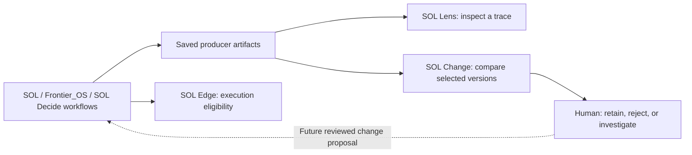

# SOL Change within the SOL continuum

Implemented October 15, 2026, as SOL Change Observatory **v0.2.0**. Here, “SOL continuum” means the whole `C:\sol-systems` workspace, including its research, agents, decision tools, policy runtime, visualizations, and continuity records.

SOL Change supplies the question **“Was this change worth keeping?”** across those parts. It compares selected observations, makes evidence and missing facts inspectable, and records the reviewer’s judgment. It does not replace the existing research kernel, decision evaluator, observable-trace viewer, or execution eligibility policy.

## Where it fits



The saved **proof-packet v0.2 → SOL Change** path is implemented here. Other artifact types still need their own explicit adapters or can use the existing run-JSON contract. The dashed feedback arrow is a future workflow proposal, not an automatic implementation or authorization mechanism.

| Component | Existing role inspected locally | Connection to Change |
| --- | --- | --- |
| `sol/` | Research kernel and diagnostics, including `diagnostics/telemetry_emitter.py`. | Native run JSON is accepted today. A dedicated benchmark adapter with explicit units and methods is planned. |
| `Frontier_OS/` | Agent orchestration, telemetry hooks, and experimental dynamics. | Source trace content is preserved when emitted through shared proof packets. No direct execution hook was added. |
| `sol-decide/` | Trade-study/decision code and proof-packet exports. | Saved v0.2 packets can be converted or imported through the new app flow. |
| `sol-edge/` | Pre-execution policy outcomes and replay. | Packet-carried references and declared statuses remain source material. This bridge does not verify event chains, issue credentials, or authorize execution. |
| `sol-lens/` | Proof-packet validation, scoring, observable trace review, and ledger views. | v0.2 packet consumer implemented; raw primary metrics and normalized `evaluation.metrics` are supported. |
| `sol-studio/` | Spatial visualization and client of the live Python server. | Saved v0.2 output is compatible. A one-click export/navigation action inside Studio is planned. |
| `sol-change/` | Cross-version comparison and reviewer decision history. | All new source, tests, schemas, default data, and launch scripts remain here. |
| `conJecture/` | Formal research notes and theorem corpus. | Can supply evidence references. Dedicated certificate intake remains planned. |
| `synThesis/` | Cross-repository research synthesis. | Can supply evidence references. No numerical metric interpretation is inferred. |

`data/`, `scripts/`, `tests/`, `docs/`, `continuity/`, `antigravityWork/`, and `codexWork/` support the continuum through stored outputs, execution entry points, checks, and handoffs. The new inventory is bounded to known public entry points and artifact patterns; it is not a recursive crawl of every file or an attestation that every subsystem is healthy.

## Implemented now

1. **App intake:** choose **SOL packets** on the experiment list, provide a title/change, and select two saved `techman.sol-lens.proof-packet/v0.2` JSON files. The app creates one review-pending experiment atomically. A malformed second packet leaves no partial experiment.
2. **Offline CLI:** `python -m observatory.continuum` supports `inventory`, `convert`, and `compare`. It does not import sibling Python packages, start workflows, access credentials, call providers, fetch evidence URLs, or write into producer projects.
3. **Source preservation:** each converted run embeds its original decoded source text, source label, digest, selected metric path, adapter version, and producer context. Evidence entries identify the original JSON pointers. The app can download the original source packet separately from the converted run.
4. **Evidence boundaries:** imported scores are automated assessments on the native 0–1 scale. They are not citation percentages, physical measurements, or independent validation. Missing execution time, USD cost, and human review remain unknown.
5. **Counterfactual handling:** `baseline_evaluation` is retained but never split out as a separately executed baseline. Both selected files contribute their own primary observation, even when one is assigned the comparison role `baseline`.
6. **Port coexistence:** SOL Change now defaults to **8770**. The existing live SOL server and its consumers keep **8765**. Existing databases remain at the same path; no data migration is required.
7. **Metadata contract:** an optional schema-1.0 context sidecar records known execution inputs and evaluation conditions without changing the upstream packet format. Unknown facts are omitted and warned about.

The original run/experiment schema remains **1.0**. This release does not change comparison arithmetic or the meaning of existing human decisions. It adds context warnings only for runs carrying this adapter’s metadata. Upstream packet verdicts such as `PROMOTE` and policy statuses such as `ELIGIBLE` never become an Observatory adoption decision or an execution approval.

## Use it

From `C:\sol-systems\sol-change`, with a Python 3.11+ interpreter:

```powershell
# Start the local reviewer app at http://127.0.0.1:8770
.\launch.ps1

# Take a bounded, read-only inventory; choose a fresh output filename
python -m observatory.continuum inventory --root .. --output data/continuum/inventory-new.json

# Convert one packet's primary observation to a baseline run
python -m observatory.continuum convert ..\sol-lens\samples\live_gemini4_wormhole_homology_packet.json --designation baseline --output data/continuum/baseline-new.json

# Prepare a portable comparison and optionally register it in the local app
python -m observatory.continuum compare --baseline path\before-packet.json --candidate path\after-packet.json --title "My workflow change" --change "Describe one proposed change" --output-dir data/continuum/my-new-comparison --register
```

If `python` is not on PATH, use the interpreter selected by `launch.ps1`, or set `SOL_CHANGE_PYTHON` to an installed interpreter. No additional packages are required. `--register` writes only to the selected Observatory database. Omit it to prepare files without adding an experiment. `--db` selects a different local database.

A comparison package contains `baseline.json`, `candidate.json`, `experiment.json`, and `comparison.md`. Import `experiment.json` through the existing **Import experiment** action to restore it elsewhere. Output files/directories are never overwritten. Registering an identical comparison again preserves its existing criteria and human decisions.

## Producer context: the next useful connection

The current saved packets inspected here do not establish the exact original execution input, controlled conditions, an evaluation implementation version, a run execution timestamp, or an explicit data origin. Those gaps remain visible. The packet’s `generated_at` is retained with an explicit **packet generated** label; it is not silently asserted to be an execution timestamp.

Use [the context contract](../schemas/continuum-context.schema.json) and [synthetic example](../examples/continuum-context.example.json) for known facts:

```json
{
  "schema_version": "1.0",
  "input": "The exact input actually supplied to this run",
  "conditions": {
    "dataset": "frozen-source-packet/1",
    "seed": 7,
    "environment": "declared-runtime-environment",
    "rubric": "frozen-rubric/1"
  },
  "evaluator_version": "producer-scoring/1",
  "workflow_version": "candidate-workflow/2",
  "executed_at": "2026-10-15T14:00:00Z",
  "data_type": "imported"
}
```

These are declared facts, not independent verification. Omit unknown fields. Mark synthetic data `synthetic`. Do not copy example metadata onto a real run as though it was captured.

Supply sidecars using `--baseline-context` / `--candidate-context` for `compare`, or `--context` for `convert`. The API accepts equivalent context objects. Embedded `observatory_context` is also understood, but the existing SOL Lens TypeScript contract does not yet declare that extension; a sidecar is the least disruptive current path. Conflicting embedded and sidecar contexts fail visibly.

For normalized packets, `evaluation.metrics` takes precedence over top-level claimed `metrics`, with a warning when they disagree. The original values remain in the embedded source. A recorded `evaluation.scoring_profile` can supply the evaluator identifier. This bridge does not recompute the scoring formula or validate upstream mathematical, policy, or physical claims.

## Local interoperability observation

The prepared experiment **SOL continuum: packet interoperability check** uses these existing saved files:

- `sol-lens/samples/live_gemini4_wormhole_homology_packet.json`
- `sol-lens/samples/live_gemini4_ricci_surgery_packet.json`

It is intentionally labeled an **interoperability check**, not a quality experiment. Their different scenario labels block a direct improvement claim. The app displays the source scores and unknown time/cost/review values, with numerical deltas withheld. No human decision was created.

The snapshot at `data/continuum/inventory-2026-10-15.json` recorded 9 component entries and 18 artifact entries, including 6 supported packet files (one pair is a byte-identical copy across directories). This is a dated filesystem observation, not six independently verified experimental runs. New producer work may add or change files after that snapshot.

The registered archive/report are in `data/continuum/packet-intake-2026-10-15/`. This directory and the SQLite database are ignored by Git, retaining the owner’s saved trace material locally.

## Next integration work for Gemini review

The proposal is to add a small producer-side exporter or sidecar writer that records exact input, controlled conditions, evaluator version, workflow/model version, and data origin for independently captured before/after runs. When actual cost/time measurements become available, emit the existing run-1.0 format with units, methods, and evidence references.

Subsequent proposals are a saved-artifact handoff button in Lens/Studio, explicit SOL Edge event-proof verification as a separate assessment, and typed adapters for benchmark reports and theorem certificates. Repeated trials should have a trial/group contract before any statistical summary is added. These are proposals for review, not completed integrations.

See [GEMINI_HANDOFF.md](GEMINI_HANDOFF.md) for a compact next-session brief and [CONTINUUM_VERIFICATION.md](CONTINUUM_VERIFICATION.md) for this release’s checks.
